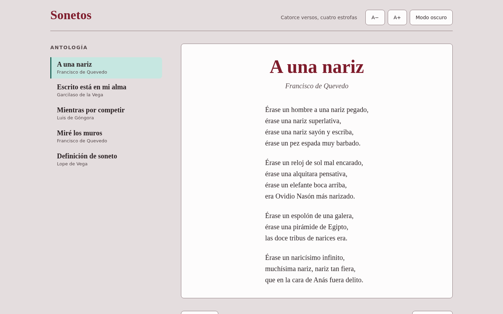

# Sonetos

[Probar en línea](https://ipo-2627-dinamarca.github.io/ipo2627_dinamarca_sonetos/)



La aplicación web consiste en un lector de sonetos. Un `soneto` es una composición poética de 14 versos organizados en cuatro estrofas fijas: dos cuartetos (de 4 versos cada uno) y dos tercetos (de tres versos cada uno). 

Los objetivos del proyecto son: 
- Diseño cromático y tipográfico


# Descripción

- La aplicación interactúa con un solo actor que es el usuario que leerá los sonetos. 
- El sistema dispondrá de un almacén de sonetos entre los que el usuario podrá escoger para proceder a su lectura. Para cada soneto, el almacén recogerá además del propio soneto, su autor y un título identificativo.
- El sistema ofrecerá un mecanismo para que el usuario escoja el soneto que desee leer con el fin de mostrarlo en pantalla. 


# Diseño

## Arquitectura 
- La aplicación deberá estar implementada siguiendo un patrón MVC (_Model-View-Controller_) con objeto de clarificar y diferenciar las distintas responsabilidades. 

## Organización 

- Tanto la distribución del código de los ficheros como la propia organización de los ficheros incluidos en la carpeta del proyecto deberán facilitar la comprensión y el mantenimiento de la solución aportada. 
- Se empleará un mecanismo moderno y apropiado para vincular los ficheros HTML, CSS y JS.

## Estilística

La vista del sistema deberá implementarse con el objeto de diferenciar los distintos aspectos considerados: diseño cromático, tipográfico y espacial. Y cada uno estará cimentado en una sólida estrategia:
  - diseño cromático: monocromática, triádica, complementaria, etc.
  - diseño tipográfico: dos fuentes contrastadas, una única fuente con niveles distintos de realce, etc.
  - diseño espacial: selección de unidades de medida y contenedores, principios de diseño `Gestalt`, etc. 

## Interacción 

La implementación de la interacción estará guiada para favorecer la usabilidad de la aplicación

# Buenas prácticas

- Se deberá cuidar el etiquetado HTML con el objeto de reflejar adecuadamente la estructura de la página y del propio soneto.
- El empleo de una estrategia de selección en CSS de elementos HTML moderna y mantenible
- Una sólida política de coordinación de JS tanto con el DOM (_Document Object Model_) como con el CSSOM (_CSS Object Model_)


# Solución

La aplicación usa solo HTML, CSS y JavaScript del navegador, sin bibliotecas, frameworks ni fuentes externas. Para probarla hay que servir la carpeta con un servidor local (Live Server, `python3 -m http.server`...), porque los módulos de JS y la petición `fetch()` de los datos no funcionan si se abre el archivo con `file://`.

La antología tiene cinco sonetos:

| Soneto | Autor |
|---|---|
| A una nariz | Francisco de Quevedo |
| Escrito está en mi alma | Garcilaso de la Vega |
| Mientras por competir | Luis de Góngora |
| Miré los muros | Francisco de Quevedo |
| Definición de soneto | Lope de Vega |

## Estructura

```
index.html                 estructura semántica de la página
css/
  tokens.css               orden de capas y variables de diseño (cromático, tipográfico, espacial)
  base.css                 reinicio, foco visible y utilidades de accesibilidad
  layout.css               reparto de la página con Grid
  components.css           aspecto de cada componente
data/
  sonetos.json             los cinco sonetos: id, titulo, autor y versos
img/
  captura.png, og.png      captura del README y vista previa al compartir el enlace
js/
  main.js                  punto de entrada: carga los datos y une modelo, vista y controlador
  model/
    soneto.js              Soneto: valida los datos y los agrupa en estrofas
    almacen.js             Almacen: carga el JSON y guarda la colección
  view/
    vista.js               la única que toca el DOM y el CSSOM
  controller/
    controlador.js         estado de la lectura y reglas de cada acción
```

## Arquitectura MVC

Los textos están en `data/sonetos.json`, que es su única fuente. Cada soneto es un objeto `{ id, titulo, autor, versos }` con sus 14 versos en orden, así que para añadir uno basta con editar el JSON. Respecto al texto de partida se corrigieron tres erratas («una alquitara», «más narizado», «Cuanto tengo»).

`Soneto` comprueba que el id, el título y el autor son texto y que hay exactamente 14 versos, y los agrupa con el getter `estrofas`: dos cuartetos y dos tercetos. `Almacen.cargar(url)` pide el JSON con `fetch()`, comprueba `respuesta.ok` y crea los `Soneto`; el constructor rechaza una lista vacía o con ids repetidos. Después el almacén guarda la colección en un campo privado y la consulta con `listar`, `total`, `obtener(id)`, `indiceDe(soneto)` y `porIndice(indice)`, que da la vuelta al pasar del último soneto al primero y al revés. Ninguna de las dos clases toca el DOM.

`Vista` crea los elementos del índice y del soneto y aplica el tema y el tamaño del texto. No toma decisiones: avisa al controlador con callbacks (`alPulsar`, `alTeclear`, `alCambiarTemaSistema`). Si los datos no cargan, `mostrarError` pone un aviso en lugar del soneto y desactiva los botones.

`Controlador` guarda el soneto actual, el tamaño y el tema, y decide qué hacer con cada acción (`ver`, `anterior`, `siguiente`, `tamano-menos`, `tamano-mas`, `tema`) o con las flechas del teclado. Pide los datos al almacén y le dice a la vista qué mostrar.

HTML, CSS y JS se vinculan con `<link>` y `<script type="module">`: los módulos se cargan sin bloquear la página y cada archivo importa solo lo que necesita. `main.js` espera con `await` a que lleguen los datos antes de arrancar el controlador; si algo falla, deja el error en la consola y la vista avisa al usuario. Mientras tanto la página muestra «Cargando los sonetos…», que también sirve de aviso si se abre con `file://` y los módulos no llegan a cargarse.

## Composición

- Grid para lo bidimensional: la página usa áreas con nombre (`cabecera`, `indice`, `lectura`, `pie`) con una columna de 15 a 20 rem para el índice y otra flexible para el soneto, en un contenedor de hasta 75 rem. El índice se queda fijo (`position: sticky`) mientras se lee.
- Por debajo de 52 rem la página pasa a una columna, en el orden del HTML (índice y después soneto), de modo que el orden del tabulador coincide con lo que se ve.
- Flexbox con `gap` para lo unidimensional: cabecera, ajustes, lista del índice, tarjeta del soneto y barra de navegación. No hay márgenes entre hermanos.
- El cuerpo del soneto mide lo que su estrofa más ancha (`width: fit-content`), con un máximo de 48 `ch` por línea, y se centra en la tarjeta. Si un verso no cabe en una línea, lo que sobra queda sangrado (sangría francesa con `padding-left` y `text-indent` de 2 `ch`).

## Estilística

Cada estrategia tiene su bloque en `css/tokens.css`, y el resto de hojas solo usa esas variables.

### Cromática

Esquema complementario con un único matiz base, el burdeos (`--matiz-primario: 350`). Su opuesto, el verde azulado, se calcula con `--matiz-complementario: calc(var(--matiz-primario) + 180)`. Cada uno tiene un papel: el burdeos es lo que se lee (el nombre de la aplicación y los títulos de los sonetos) y el verde azulado es lo que se puede tocar (foco, botón pulsado y soneto activo del índice).

El fondo, las superficies y el texto son neutros del mismo matiz que el burdeos, con poca saturación y sin negro ni blanco puros, así que la paleta solo tiene dos tonos. Todo está en `hsl()` con `var()` y `calc()`. El modo claro y el oscuro se resuelven con `light-dark()`, y el botón de tema fija `color-scheme` mediante el atributo `data-tema` de `<html>`.

Contrastes calculados sobre los valores de `tokens.css`: el texto principal pasa de 10:1 en los dos modos, el texto secundario de 6:1, el burdeos sobre la tarjeta de 6,5:1 y los bordes de los controles de 3:1 sobre el fondo y sobre la superficie.

### Tipográfica

Dos fuentes contrastadas, las dos del sistema para no descargar nada. La voz poética (títulos, versos, nombres del índice) va en serifa (`Palatino Linotype`, Palatino, Georgia) y la interfaz (botones, etiquetas, avisos) en la sans del sistema. La serifa da el carácter de libro y la sans se lee bien en tamaños pequeños.

Los tamaños, pesos e interlineados son variables: una escala de 13, 14, 16, 20 y 36 px, un título fluido con `clamp()` que va de 32 a 54 px y un tamaño de lectura que parte de 20 px. Los componentes no llevan valores sueltos. Solo el título del índice va en mayúsculas espaciadas, porque es una etiqueta corta.

### Espacial

Unidades `rem` con una escala de espaciado que sube con razón 1,5 (1 → 1,5 → 2,25 → 3,375) y baja dividiendo entre 2 (0,5 → 0,25). La medida de línea se fija en `ch`, que es la unidad que sigue al tamaño de la letra. Los radios son de 0,5 rem.

Principios de la Gestalt:

- Proximidad: los versos de una estrofa van juntos y las estrofas se separan entre sí.
- Semejanza: todas las estrofas comparten estilo, tanto las de cuatro versos como las de tres.
- Cierre: la tarjeta con borde enmarca el soneto como una unidad.
- Figura y fondo: superficie clara sobre un fondo más oscuro en modo claro, y al revés en modo oscuro.

Botones y controles miden al menos 44 px para poder pulsarlos con el dedo.

## Interacción y usabilidad

- Se elige el soneto en la lista «Antología», con los botones Anterior y Siguiente o con las flechas del teclado. El atajo no se activa si se pulsa con Alt, Ctrl, Meta o Mayús, para no pisar los del navegador, y mantener pulsada la flecha no recorre la lista.
- Estado visible: el soneto abierto se marca en el índice (`aria-current`) y debajo del soneto aparece su posición («1 de 5»). Del último se pasa al primero y del primero al último.
- Ajustes de lectura: tamaño del texto con A− y A+ (de 16 a 28 px, en pasos de 4) y modo oscuro. Al abrir la página se respeta el tema del sistema y se sigue su cambio hasta que el usuario pulsa el botón. El título de la pestaña cambia con el soneto.
- En móvil, al elegir un soneto en el índice la página baja hasta su principio, pero solo si el título no está ya a la vista; en escritorio no se mueve.
- Accesibilidad: enlace «Saltar al soneto», foco visible, `aria-pressed` y `aria-current` para los estados y respeto a `prefers-reduced-motion` (las transiciones pasan a 0 s). Con Anterior, Siguiente o las flechas, el soneto nuevo se anuncia en una región `aria-live` oculta («Miré los muros, 4 de 5»). Al elegir en el índice, el foco pasa al título del soneto y no se anuncia dos veces. A− y A+ usan `aria-disabled` en los límites para no perder el foco.
- Los botones empiezan desactivados en el HTML y se activan cuando los sonetos han cargado. Si no se pueden cargar, la página lo explica y siguen desactivados.

## Recursos de CSS

- Capas (`@layer tokens, base, layout, componentes`), declaradas una sola vez: el orden de las capas decide qué regla gana, así que no hacen falta `!important` ni selectores largos.
- `:where()` en el reinicio para dejar su especificidad a cero y que cualquier componente la supere.
- Clases con nomenclatura BEM (`soneto__estrofa`, `soneto__verso`, `indice__boton`, `pasar__posicion`...) y anidamiento nativo para los estados (`&:hover`, `&[aria-current="true"]`, `&:disabled`).
- Los estados visuales se leen de atributos ARIA (`aria-pressed`, `aria-current`, `aria-disabled`), así el estilo y la accesibilidad no pueden desincronizarse.
- `.solo-lector` oculta sin quitar del árbol de accesibilidad los avisos y los nombres de estrofa, y el enlace de salto usa la misma técnica hasta recibir el foco.

## Buenas prácticas

- HTML semántico: `header`, `nav`, `main` y `footer`; un único `h1` y un `h2` por apartado; `article` para el soneto, una `section` por estrofa con un `h3` solo para lectores de pantalla («Primer cuarteto»...) y un `p` por verso. Las dos navegaciones llevan nombre accesible.
- JS y DOM: la vista localiza los elementos por `data-vista` y `data-accion` (las clases quedan para el estilo) y un único escuchador en `document` atiende todos los botones por delegación de eventos.
- JS y CSSOM: el JS no escribe estilos sueltos. Lee el tamaño inicial de `--tamano-lectura` con `getComputedStyle`, cambia solo esa variable y el atributo `data-tema`, y el CSS decide cómo se ve.
